# IronForge Athletics

## Live Project

- [Live Website](https://ironforge-athletics-11c14a1e531e.herokuapp.com/)
- [GitHub Repository](https://github.com/alancoomeynts-hub/ironforge-athletics)

---

## Table of Contents

- [UX](#ux)
  - [Primary Goal](#primary-goal)
  - [Business Needs](#business-needs)
  - [User Needs](#user-needs)
  - [Agile Planning](#agile-planning)
  - [Design Choices](#design-choices)
  - [Component Selection](#component-selection)
  - [Responsive Design](#responsive-design)
  - [Database Model Overview](#database-model-overview)
- [Features](#features)
  - [1. Responsive Navigation Bar](#1-responsive-navigation-bar)
  - [2. Public Homepage and Marketing Pages](#2-public-homepage-and-marketing-pages)
  - [3. Contact Form](#3-contact-form)
  - [4. User Authentication and Account Management](#4-user-authentication-and-account-management)
  - [5. Membership Plans](#5-membership-plans)
  - [6. Membership Subscription with Stripe Checkout](#6-membership-subscription-with-stripe-checkout)
  - [7. Membership Management](#7-membership-management)
  - [8. User Dashboard and Profile Management](#8-user-dashboard-and-profile-management)
  - [9. Product Catalogue](#9-product-catalogue)
  - [10. Product Detail and Reviews](#10-product-detail-and-reviews)
  - [11. Shopping Cart](#11-shopping-cart)
  - [12. Shop Checkout with Stripe](#12-shop-checkout-with-stripe)
  - [13. Community Board](#13-community-board)
  - [14. Admin Management](#14-admin-management)
  - [15. Feedback Messages and Toast Notifications](#15-feedback-messages-and-toast-notifications)
  - [16. Responsive Layout and UI Components](#16-responsive-layout-and-ui-components)
- [Future Features](#future-features)
- [Testing](#testing)
  - [JavaScript Manual Testing](#javascript-manual-testing)
  - [Automated Python Testing](#automated-python-testing)
  - [Stripe Integration Testing](#stripe-integration-testing)
  - [Validation and Accessibility Testing](#validation-and-accessibility-testing)
- [Code](#code)
  - [Code Sources and Credits](#code-sources-and-credits)
  - [Bugs and Fixes](#bugs-and-fixes)
- [Tools and Resources](#tools-and-resources)
- [Deployment](#deployment)
  - [Heroku Deployment](#heroku-deployment)
  - [Deployment Steps](#deployment-steps)
  - [Required Configuration Variables](#required-configuration-variables)
  - [Local Deployment](#local-deployment)
  - [Stripe Configuration](#stripe-configuration)
---

## UX
### Primary Goal
IronForge Athletics is a modern support and membership platform for a local gym. Its primary purpose is to attract new
members by helping them understand the gym’s services and choose the membership that best suits their goals. It also provides
existing members with access to fitness and nutrition resources, member-only discounts in the online shop, and opportunities
to engage with the wider IronForge community.
The central offering is a full gym membership. Alongside membership access, the platform provides:
- Exercise and nutrition plans.
- An online shop selling fitness and nutrition products, as well as branded IronForge Athletics merchandise. The shop is open
to everyone, although gym members receive exclusive discounts.
- Product reviews from customers.
- Member profiles.
- Community progress updates, where members can share their achievements and experiences.
### Business Needs
- Promote the local gym, its facilities, and services.
- Convert visitors into gym members through a clear and secure subscription process.
- Provide access to fitness and nutrition resources.
- Provide member-only discounts in the online shop.
- Build a supportive and engaged fitness community.
- Encourage members to share their experiences and achievements.
- Provide administrative tools for managing the platform, memberships, products, product reviews, users, and subscription payments.

### User Needs
#### Potential Gym Members:
- Understand the gym’s facilities, services, location, and training environment.
- Compare membership options, prices, benefits, and included services.
- Register for an account and complete a secure membership subscription.
- Decide confidently whether IronForge Athletics suits their goals and experience level.
#### Gym Members:
- Log in securely and view their membership and subscription details.
- Access member-only exercise and nutrition resources.
- Access the external class-booking application through a clear link.
- View gym message board for announcements and community updates.
- Manage their profile and share their fitness progress.
- Purchase products or branded merchandise and review eligible purchases.
Note: Class scheduling will be handled by third-party appointment scheduling software outside of the IronForge Athletics platform.
#### Shop Customers:
- Be able to browse products
- View product details including price, description.
- Be able to add the product to their cart.
- Be able to view their cart and checkout.
- Be able to view their order history.
- Complete the checkout process anonymously or with a registered account.
#### Community Users
Registered community users need to:
- Access a welcoming and motivating online community.
- Share fitness achievements and progress updates.
- Interact positively with other users.
#### Administrators
Administrators need to:
- Manage users, memberships, subscriptions, products, orders, and reviews.
- Create and update membership, exercise, and nutrition plans.
- Manage product categories, images, prices, and stock information.
- Moderate reviews and community progress updates.
- Publish gym announcements and maintain class-booking information.

### Agile Planning
#### User Stories
1. As a potential gym member, I want to learn about the gym's facilities and services so I can decide whether IronForge Athletics is right for me.
2. As a potential gym member, I want to register for an account.
3. As a potential gym member, I want to view my membership details so I can compare membership options and decide whether IronForge Athletics is right for me.
4. As a potential gym member, I want to subscribe to a membership so I can access fitness and nutrition resources.
5. As a gym member, I want to view my subscription details so I can edit or cancel my subscription.
6. As a gym member, I want to view and edit my profile so I can share my fitness progress, review past shop orders.
7. As a gym member, I want to view a gym message board so I can stay informed about the gym's activities and community, and share my fitness achievements with other members.
8. As a shop customer, I want to browse products so I can find the products that interest me.
9. As a shop customer, I want to view product details so I can decide whether to purchase the product.
10. As a shop customer, I want to add the product to my cart so I can purchase multiple products at once.
11. As a shop customer, I want to view my cart so I can review my order before checkout.
12. As a shop customer, I want to complete checkout securely so I can purchase the products in my cart.
13. As site administrator, I want to be able to manage users, memberships, products, shop orders, and the message board.
#### Issues
| Epic | Related User Stories          | Main Issues / Features | Priority | Status |
|---|-------------------------------|---|---|---|
| Marketing and Public Content | User Story 1                  | Homepage, About page, Contact page, facilities and services information, calls to action, public navigation | Must Have | Complete |
| User Accounts and Profiles | User Stories 2, 6             | Registration, login, logout, email verification, profile creation, profile editing, user dashboard, order history, community activity | Must Have | Complete |
| Memberships and Subscriptions | User Stories 3, 4, 5          | Membership plan comparison, Stripe subscription checkout, membership status, Stripe Customer Portal, member-only access control | Must Have | Complete |
| Shop and Checkout | User Stories 8, 9, 10, 11, 12 | Product catalogue, product detail pages, product reviews, cart management, logged-in checkout, Stripe payments, order history | Must Have | Complete |
| Community | User Story 7                  | Member-only community board, posts, comments, create/edit/delete permissions, pagination, moderation support | Should Have | Complete |
| Admin and Site Management | User Story 13                 | Django admin management for users, profiles, memberships, products, orders, reviews, contact messages, community posts and Stripe events | Must Have | Complete |
| Responsive Design and User Feedback | All User Stories              | Mobile-first responsive layout, Bootstrap components, toast messages, validation feedback, custom error handling | Must Have | Complete |
| Testing, Deployment, and Documentation | All User Stories              | Manual testing, automated testing, validation, accessibility checks, Stripe testing, Heroku deployment, README documentation | Must Have | Complete |
| Future Enhancements | N/A                           | Search, improved product images, enhanced permissions, post drafts, additional review controls, social login | Could Have | Planned |


### Design Choices
#### Layout Design

The site uses a conventional responsive layout consisting of a fixed header with internal main navigation bar,
a main content area, and a footer. The interface was developed iteratively without formal wireframes.

#### Color Scheme
The color palette was chosen to create a strong, modern, and energetic fitness brand identity. The design aims to feel professional, motivational, and suitable for a local gym with an online shop and member community.
- **Primary Navy (#1a1c37):** Used for the main navigation bar, footer, and key structural areas.
- **Secondary Slate Blue (#4b556f):** Used for the header, secondary buttons, and supporting interface elements.
- **Action Green (#46c855):** Used for primary call-to-action buttons, active navigation states, and important interactive highlights.
- **Dark Action Green (#3aa847):** Used for hover states on primary call-to-action elements, providing clear visual feedback.
- **Secondary CTA Hover (#3a4155):** Used for hover states on secondary buttons, maintaining consistency with the slate-blue interface style.
- **Light Background (#eef2f6):** Used as the main page background to keep the site clean, bright, and readable.
- **White (#ffffff):** Used for content cards, form backgrounds, and text on darker sections.
- **Black (#000000):** Used for standard body text where high contrast is required.
The contrast between the dark navy interface areas and bright green calls to action helps guide users toward important actions such as registering, joining a membership, viewing products, and proceeding to checkout.

#### Typography
The typography was selected to balance strength, readability, and a modern fitness-focused aesthetic.
- **Oswald:** Used for headings, navigation links, buttons, labels, and key interface text. Its condensed, bold appearance gives the site a strong gym-brand feel and helps important text stand out.
- **Inter:** Used for body text and general readable content. Inter provides clean legibility across screen sizes and works well for longer sections such as product descriptions, profile content, forms, and community posts.
This combination creates a clear hierarchy: Oswald provides visual impact for headings and actions, while Inter keeps the main content easy to read.


#### Layout & Navigation
The site uses a structured, responsive layout designed to support several user journeys.
The main navigation provides access to:
- Homepage
- About page
- Contact page
- Membership section
- Shop
- Community area
- Cart
- User dashboard/profile options
- Authentication links for registration, login, and logout
- Admin area access for staff users where appropriate
My Account dropdown updates based on user authentication and membership status, ensuring that visitors, members, and administrators are presented with relevant actions.
The layout uses Bootstrap components and responsive utility classes to maintain a consistent structure across the application.
#### Homepage Layout
The homepage is designed as a marketing entry point for potential members. It introduces IronForge Athletics as a local gym and encourages visitors to explore facilities, services, membership options, and the shop.
Key homepage design intentions include:
- Strong hero imagery to create an immediate fitness-focused impression.
- Clear calls to action encouraging users to register or view membership options.
- Sections introducing gym services, facilities, and the training environment.
- Responsive image/text content blocks for easy scanning on desktop and mobile.
#### Header and Navigation
The header separates brand, navigation, search, cart, and user account actions into a clear layout.
Navigation behavior includes:
- Desktop-friendly navigation links for primary pages.
- Responsive mobile navigation using Bootstrap components.
- Active navigation styling to show the user’s current section.
- Cart visibility for shop users.
- User-specific links for account, profile, dashboard, and logout actions.
#### User Feedback
The site uses visual feedback to keep users informed when they complete actions.
Feedback includes:
- Toast messages for success, error, and informational messages.
- Form validation feedback.
- Confirmation messages when products are added to or removed from the cart.
- Membership and payment flow messages.
- Community post and comment action feedback.

### Component Selection

#### Marketing Pages
Public marketing pages are used to introduce the gym, explain its services, and provide contact information. These pages are designed for potential members who want to understand the gym before registering or subscribing.
They include:
- Homepage hero section.
- About page content.
- Contact page with gym details and enquiry form.
- Membership overview links and calls to action.
#### Membership Cards
Membership options are displayed using a card-based layout. This makes it easier for users to compare plan names, prices, descriptions, and benefits.
Membership cards are used to:
- Present available membership types.
- Show key benefits clearly.
- Provide a direct join action.
- Redirect active members toward membership management instead of duplicate signup.
#### Stripe Checkout and Billing Portal
Stripe is used for secure payment handling. The design separates local application content from secure payment processing by redirecting users to Stripe-hosted checkout and billing management pages.
This supports:
- Membership subscriptions.
- One-off shop payments.
- Secure card handling.
- Subscription management through the Stripe Customer Portal.
- Webhook-based updates to local membership and order records.
#### Product Catalogue
The shop uses product listing and detail pages to allow users to browse fitness, nutrition, recovery, accessory, and branded merchandise products.
The product catalogue includes:
- Product cards or list items.
- Product names.
- Prices.
- Product descriptions.
- Product images.
- Category filtering.
- Links to product detail pages.
#### Product Detail Pages
Product detail pages provide more information before purchase.
They include:
- Product name.
- Product description.
- Price.
- Product image or fallback image.
- Quantity selection.
- Add-to-cart button.
- Product review section.
- Review form for eligible users.
#### Cart and Checkout
The cart and checkout flow is designed to be clear and simple.
The cart allows users to:
- View selected products.
- Review quantities.
- Update item quantities.
- Remove products.
- View cart totals.
- Continue to checkout.
The checkout process collects order and shipping information before redirecting users to Stripe for payment.
#### User Dashboard
The user dashboard acts as a central account area for registered users and members.
It provides access to:
- Profile information.
- Profile editing.
- Membership status and membership management.
- Shop order history.
- Community post history.
This gives users one place to manage their interaction with the IronForge Athletics platform.
#### Profile Pages
Member profile pages allow users to share information about themselves and their fitness journey.
Profile-related features include:
- Username and account details.
- Bio.
- Fitness goals.
- Profile image.
- Personal details used for account and order convenience.
- Links to community posts and order history.
#### Community Board
The community board supports member engagement by allowing active members and staff to create posts and comments.
The community area includes:
- Published community posts.
- Post detail pages.
- Post creation.
- Draft and published post states.
- Commenting.
- Editing and deleting posts or comments where permissions allow.
- Member-only access restrictions.
This feature supports the project goal of creating a motivating and supportive fitness community.
#### Contact Form
The contact form allows visitors to send enquiries to the gym.
It collects:
- Name.
- Email.
- Phone number.
- Subject.
- Message.
The form uses CSRF protection and styled form fields to maintain consistency with the rest of the site.
#### Admin Interface
The Django admin interface is used to manage key application content and data.
Administrators can manage:
- Gym information.
- Contact submissions.
- User profiles.
- Membership types.
- Membership records.
- Products.
- Categories.
- Product reviews.
- Orders and order items.
- Community posts, comments, and images.
- Stripe event logs.
This allows the site owner to maintain the platform without editing the database directly.


### Responsive Design
The site is designed with a mobile-first approach using Bootstrap 5. Layouts adapt across different screen sizes to ensure that the platform remains usable on mobile phones, tablets, laptops, and desktop screens.
#### Breakpoints
- **< 576px:** Single-column layouts, simplified spacing, stacked buttons, mobile-friendly forms, and compact navigation.
- **576px - 768px:** Improved spacing while keeping most content stacked for readability.
- **768px - 992px:** Multi-column layouts begin to appear for cards, marketing sections, and shop content.
- **992px - 1200px:** Wider layouts improve readability for product pages, dashboards, tables, and membership cards.
- **> 1200px:** Expanded desktop layouts provide comfortable spacing and clearer content separation.
#### Key Responsive Behaviours
- Navigation adapts for smaller screens using responsive Bootstrap patterns.
- Homepage content stacks vertically on mobile and uses wider layouts on larger screens.
- Membership cards stack on smaller screens and display in rows on larger screens.
- Product listings adjust from single-column mobile layouts to multi-column desktop layouts.
- Product detail content remains readable on mobile and expands on larger screens.
- Cart and order information are displayed in responsive layouts to avoid horizontal overflow.
- Dashboard sections stack on smaller screens for easier reading.
- Forms use full-width inputs on mobile devices.
- Buttons stack on smaller screens where needed and align inline on larger screens.
- Tables and order history sections are wrapped or structured to remain usable on smaller devices.
- Footer links and supporting information remain accessible while avoiding clutter on mobile.
The responsive design ensures that users can browse the gym information, register, manage memberships, shop, checkout, edit profiles, and participate in the community from any device.


### Database Model Overview

The project uses several Django models to manage gym information, user profiles, memberships, shop products, orders, reviews, community content, and Stripe event tracking.

| Model             | Purpose                                                                                                                                 |
|-------------------|-----------------------------------------------------------------------------------------------------------------------------------------|
| `Gym`             | Stores core gym details such as name, phone number, email address, description, opening hours, and address                               |
| `ContactSubmission` | Stores contact form submissions from visitors, including name, email, phone number, subject, message, and submission date              |
| `Profile`         | Stores additional user profile information linked to a Django user account, including bio, goals, profile image, fitness details, and default contact/address details |
| `MembershipType`  | Stores available gym membership plans, including name, slug, price, description, benefits, Stripe product/price IDs, and availability status |
| `Membership`      | Stores a user’s gym membership subscription, including membership type, Stripe customer/subscription/session IDs, subscription status, join date, and renewal/cancellation details |
| `Category`        | Groups shop products into categories for filtering and organisation                                                                      |
| `Product`         | Stores shop product details such as name, slug, SKU, description, price, category, image, availability status, and timestamps            |
| `ProductReview`   | Stores customer product reviews, including the reviewed product, user, rating, comment, and review timestamps                            |
| `Order`           | Stores shop order details, including user, payment status, shipping method, shipping cost, Stripe payment details, customer contact details, address, and order totals |
| `OrderItem`       | Stores individual products within an order, including the product, quantity, price at time of purchase, and calculated line total         |
| `Post`            | Stores community board posts created by members or staff, including author, title, slug, content, status, and timestamps                 |
| `PostImage`       | Stores images attached to community posts, including the uploaded image and optional caption                                             |
| `Comment`         | Stores comments and replies on community posts, including author, parent comment where applicable, content, and timestamps               |
| `StripeEventLog`  | Stores processed Stripe webhook event IDs and event types to help prevent duplicate webhook handling                                     |                    

### Entity Relationship Model:

<details>
<summary>Click to expand</summary>
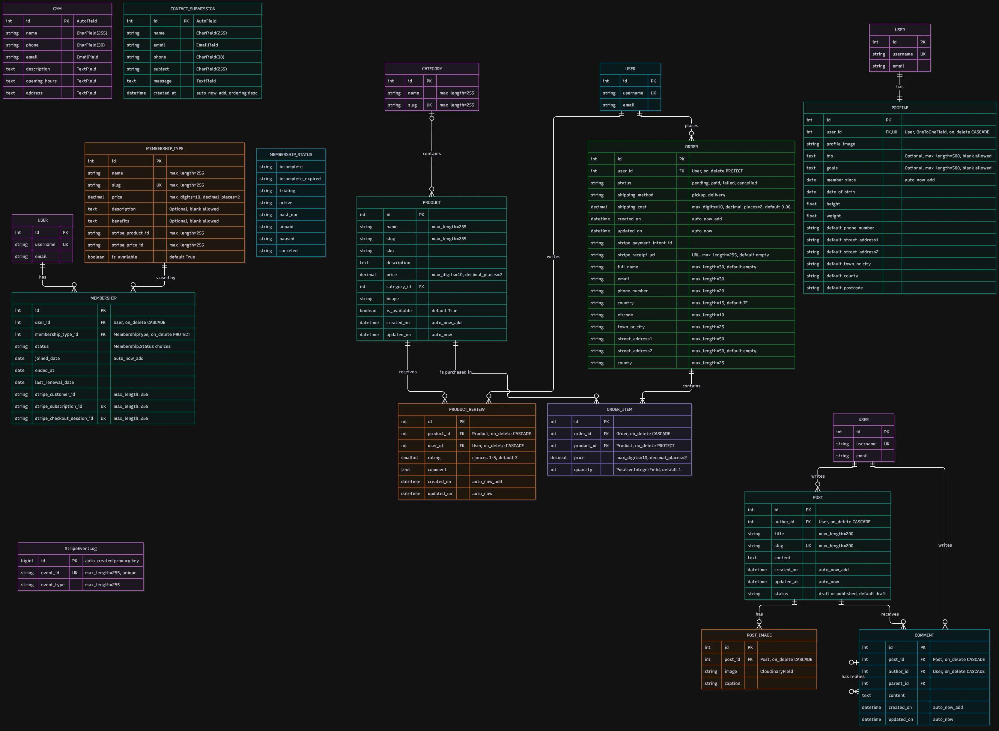
</details>

----

## Features
IronForge Athletics is built as a responsive Django web application for a local gym, combining public marketing pages, membership subscriptions, an online shop, user profiles, and a member-only community area. The site is designed to support both potential members and existing gym members by providing clear navigation, secure account access, Stripe-powered payment flows, and responsive layouts across desktop and mobile devices.
Key features include:
### 1. Responsive Navigation Bar
**Description:**
Responsive navigation system that gives users access to the main areas of the site and adapts depending on authentication status.
**Details:**
- Provides links to key public pages such as Home, About, Contact, Memberships, and Shop.
- Includes access to the Community area for eligible users.
- Displays account-related links based on whether the user is logged in or logged out.
- Logged-out users can access registration and login links.
- Logged-in users can access profile/dashboard and logout options.
- Cart access is available for users browsing the shop.
- A Memberships or Join link supports the main business goal of converting visitors into gym members.
- Mobile navigation is designed to remain usable on smaller screens.
**Technical Details:**
- Built with Django templates and Bootstrap 5.3 responsive components.
- Uses Django template logic to conditionally display user-aware navigation items.
- Styled with custom CSS variables and project-specific brand colours.
- Navigation structure supports the main user journeys: joining, shopping, account management, and community access.
- 
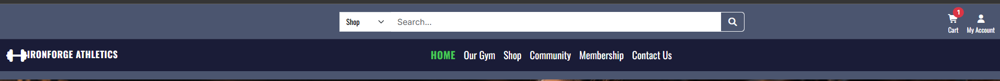
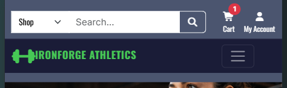


### 2. Public Homepage and Marketing Pages

**Description:**  
Public-facing pages introduce IronForge Athletics, explain the gym’s purpose, and guide visitors toward membership options.

**Details:**

- Homepage introduces the IronForge Athletics brand and gym offering.
- Hero imagery creates an immediate fitness-focused impression.
- Clear calls to action guide users toward registration and membership plans.
- About content provides information about the gym, training environment, and services.
- Contact page allows visitors to find gym information and submit enquiries.
- Marketing pages support potential members who want to understand the gym before committing.

**Technical Details:**

- Built using Django templates.
- Uses responsive Bootstrap layouts for page sections.
- Static and uploaded media support branded imagery.
- Contact and gym information can be managed through database-backed models where applicable.

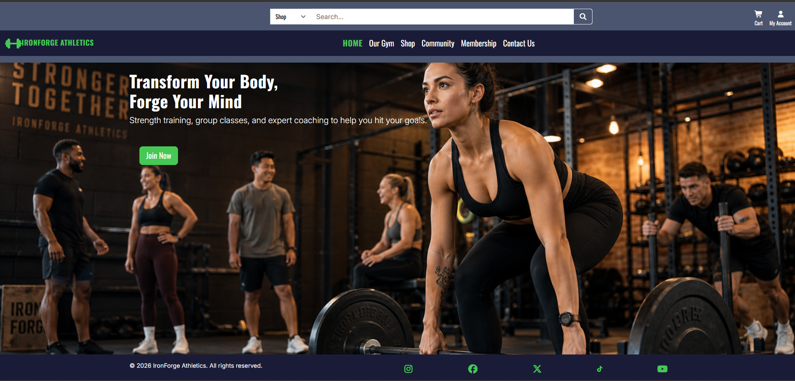

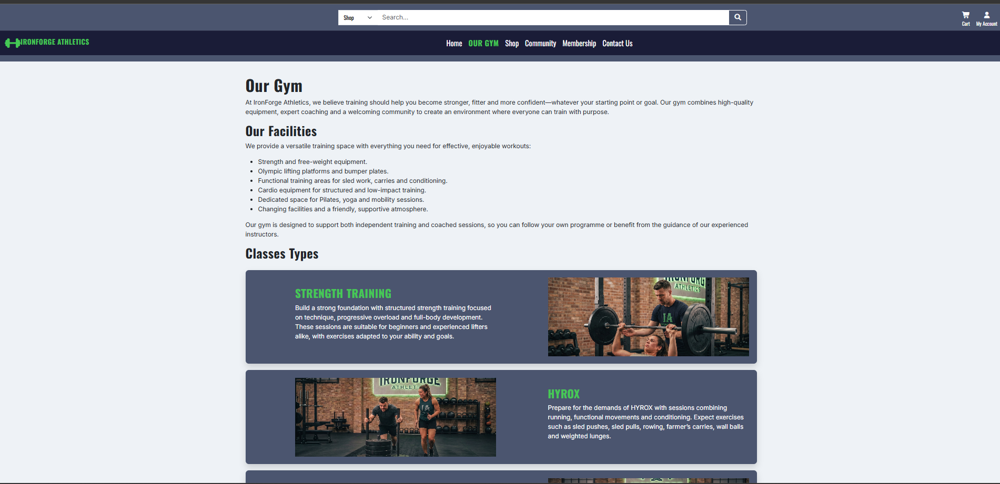


### 3. Contact Form
**Description:**
Dedicated contact form allowing visitors to send enquiries to IronForge Athletics.
**Details:**
- Visitors can submit general enquiries through the Contact page.
- Collects name, email address, phone number, subject, and message.
- Displays success feedback after a valid form submission.
- Allows gym administrators to review submitted contact messages.
- Provides a direct communication route for potential members, customers, and community users.
**Technical Details:**
- Built with a Django ModelForm.
- Uses server-side validation.
- Protected with CSRF protection.
- Styled consistently with the wider site form design.
- Contact submissions are stored in the database and accessible to administrators.
- 
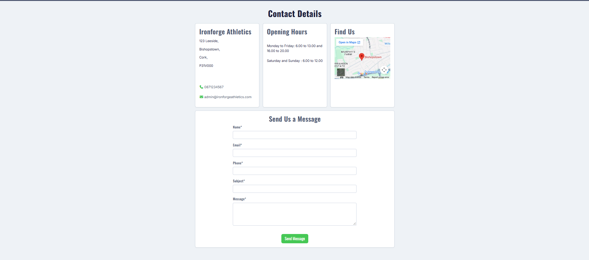


### 4. User Authentication and Account Management

**Description:**  
Authentication system that allows users to register, log in, log out, verify their email, and access account-specific areas.

**Details:**

- Users can register for an account.
- Users can log in and log out securely.
- Email verification is used during account registration.
- Authentication state controls which navigation links are displayed.
- Registered users can access their dashboard.
- Logged-in users can manage profile details and view account-related activity.
- Access to some areas, such as membership management and community participation, is restricted based on login and membership status.

**Technical Details:**

- Powered by Django Allauth.
- Uses custom authentication forms and templates.
- User profile records are automatically created for new users.
- Protected views use Django authentication controls.
- Email verification uses the configured email backend.

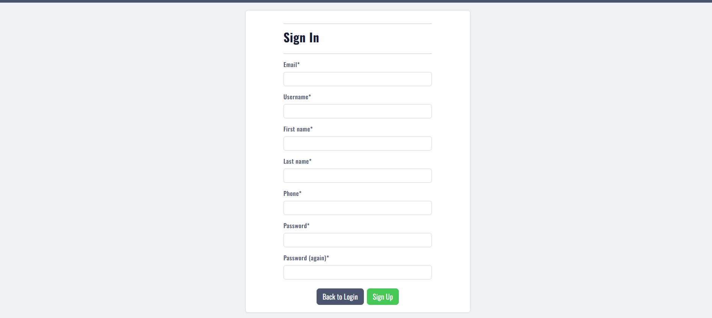

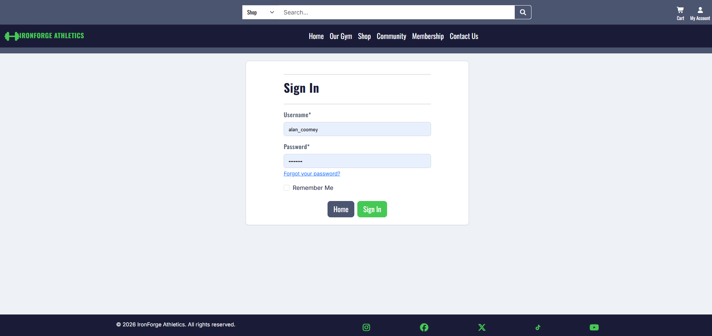


### 5. Membership Plans
**Description:**
Membership plans page where visitors and registered users can view available gym membership options.
**Details:**
- Displays available membership types.
- Shows plan name, price, description, and benefits.
- Allows potential members to compare membership options.
- Provides a clear join action for each available plan.
- Logged-out users are encouraged to register or log in before subscribing.
- Logged-in non-members can proceed toward subscription checkout.
- Existing members are guided toward membership management rather than duplicate signup.
**Technical Details:**
- Membership plans are database-driven.
- Available plans can be managed by administrators.
- Uses responsive card-based layouts for clear plan comparison.
- Membership display logic checks whether the current user already has a relevant membership.

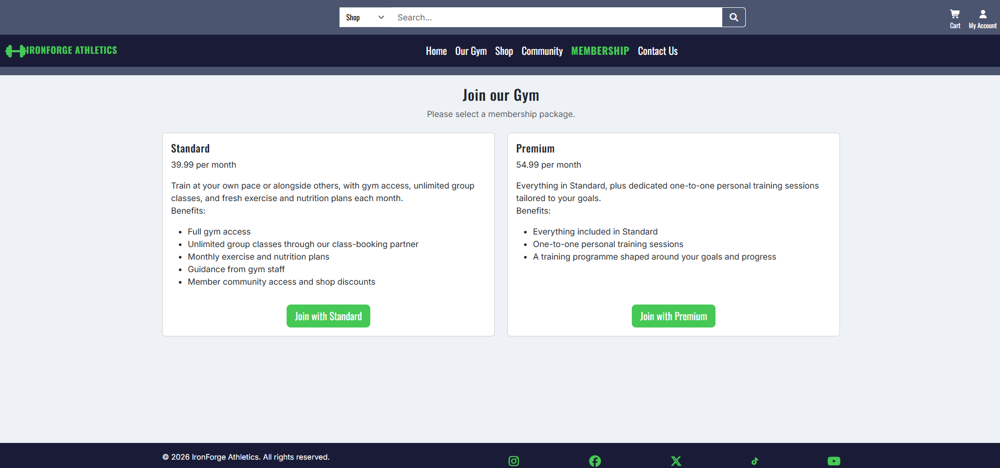


### 6. Membership Subscription with Stripe Checkout

**Description:**  
Secure subscription flow allowing users to become gym members through Stripe Checkout.

**Details:**

- Logged-in users can select a membership plan.
- Users are redirected to Stripe-hosted checkout to complete subscription payment.
- Successful subscription payment creates or updates the local membership record.
- Active memberships provide access to member-only areas.
- Failed or cancelled payments do not create an active membership.
- Users receive feedback if they attempt to subscribe while already holding a membership.

**Technical Details:**

- Uses Stripe Checkout for subscription payments.
- Membership records store Stripe-related identifiers and subscription status.
- Stripe webhook events update local membership data.
- Subscription creation links the selected membership type to the authenticated user.
- Payment handling is kept outside the main application interface for improved security.

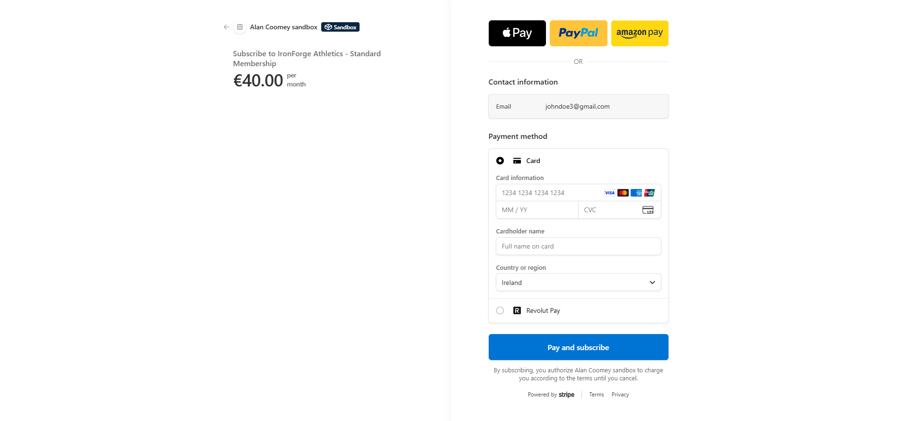

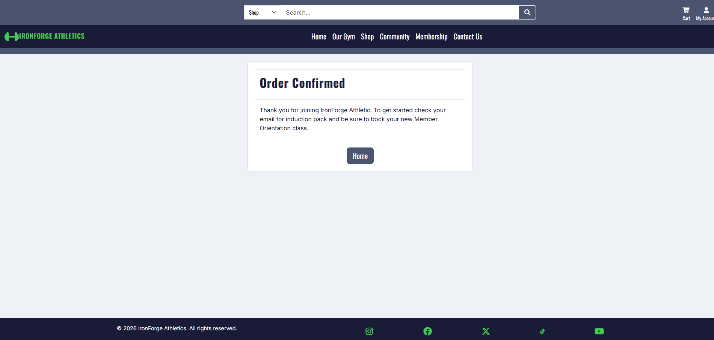


### 7. Membership Management
**Description:**
Membership management flow allowing active members to manage their subscription.
**Details:**
- Active members can access a membership management route.
- Members can be redirected to the Stripe Customer Portal.
- The portal allows subscription management, such as updating or cancelling membership.
- Non-members are redirected back to the join page.
- Membership status is used to control access to member-only functionality.
**Technical Details:**
- Uses Stripe Customer Portal for subscription management.
- Membership access checks confirm that the user has an active membership.
- Local membership records are updated through Stripe webhook events.
- Protected views prevent unauthorised access to membership management.
- 
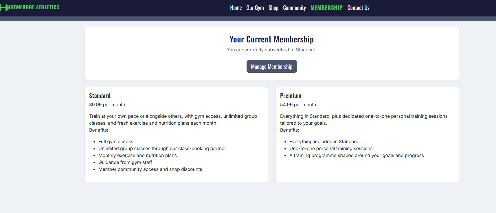
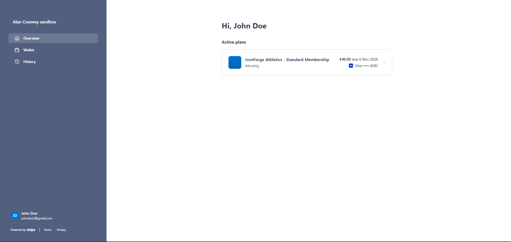


### 8. User Dashboard and Profile Management

**Description:**  
User dashboard where registered users can view and manage account information, membership status, order history, and community activity.

**Details:**

- Displays user account and profile information.
- Shows current membership details where applicable with link to Stripe portal.
- Provides access to profile editing.
- Displays shop order history with links to Stripe receipts.
- Displays the user’s community post history.
- Supports profile fields such as bio, goals, profile image, contact details, and default address information.
- Gives users a central place to manage their interaction with the platform.

**Technical Details:**

- Uses a linked user profile model.
- Profile records are automatically created when users register.
- Profile edit forms update user and profile information.
- Dashboard data is pulled from related membership, order, and community records.
- Protected by login requirements.
- Member profile pages can be viewed by other users.

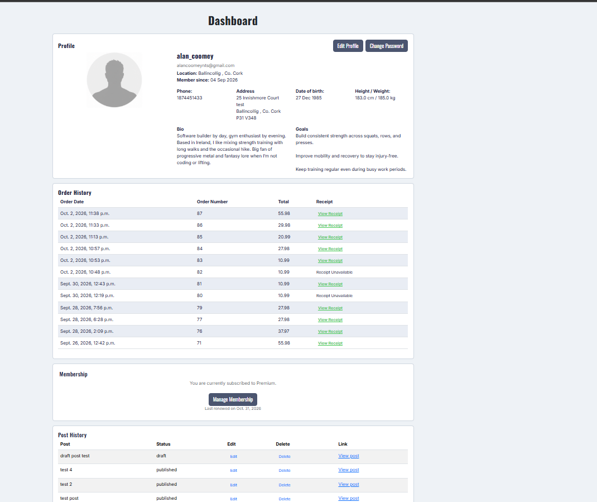

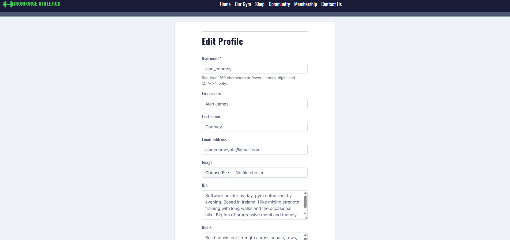

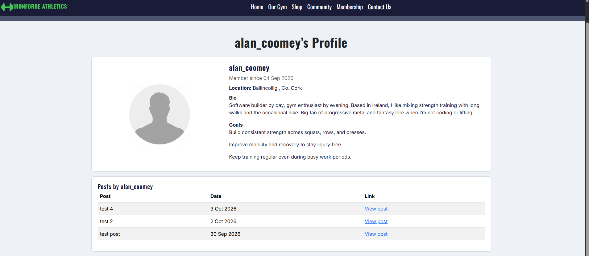

### 9. Product Catalogue
**Description:**
Public product catalogue allowing users to browse fitness, nutrition, recovery, accessory, and branded gym products.
**Details:**
- Displays available products.
- Products are organised by category.
- Users can filter the product list by category.
- Product cards or listings show product name, price, image.
- Each product links to a product detail page.
- Catalogue is accessible to visitors and logged-in users.
- Supports the gym’s secondary business goal of providing members with fitness products and merchandise.
**Technical Details:**
- Product and category data are database-driven.
- Product availability controls whether items appear in the catalogue.
- Product images are supported through media storage.
- Uses Django templates and Bootstrap responsive layouts.
- Category-based URLs support filtered product views.

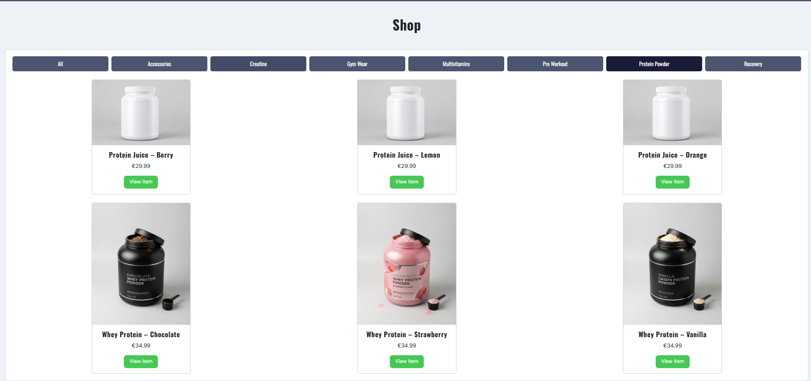

### 10. Product Detail and Reviews

**Description:**  
Product detail pages provide customers with information needed to decide whether to purchase a product.

**Details:**

- Displays product name.
- Displays full product description.
- Displays product price.
- Shows product image or fallback image where needed.
- Provides quantity selection.
- Includes an Add to Cart button.
- Displays product reviews.
- Allows eligible users to submit product reviews.
- Review ratings help users evaluate products before purchase.

**Technical Details:**

- Product detail pages are powered by database product records.
- Product reviews are linked to both products and users.
- Review ratings are validated.
- Review form uses Django form handling and server-side validation.
- Duplicate product reviews by the same user are restricted at model level.

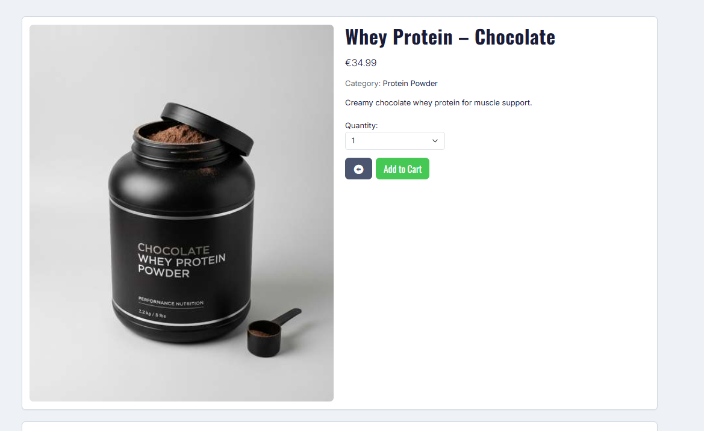


### 11. Shopping Cart
**Description:**
Session-based shopping cart that allows users to collect and manage products before checkout.
**Details:**
- Users can add products to their cart.
- Users can select product quantities.
- Cart displays selected products, quantities, item prices, and line totals.
- Users can update quantities.
- Users can remove products from the cart.
- Cart total updates when items are changed.
- Cart contents are retained in the session while the user browses.
**Technical Details:**
- Cart data is stored in the user session.
- Cart helper logic calculates line totals and cart totals.
- Quantity updates can be handled dynamically for improved user experience.
- Django messages provide feedback when products are added or removed.
- Cart context is available across templates where needed.

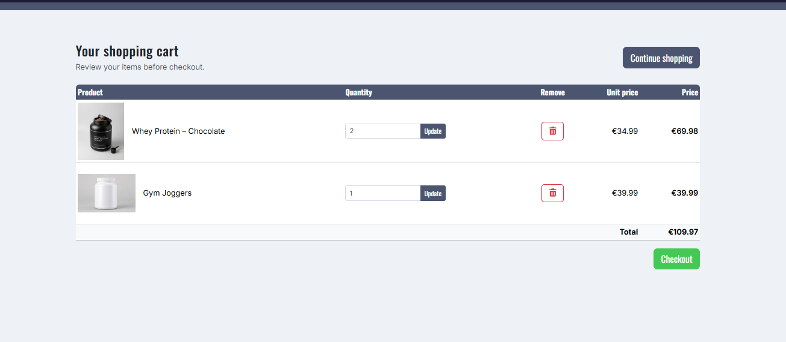


### 12. Shop Checkout with Stripe

**Description:**  
Secure checkout flow allowing logged-in users to complete one-off product purchases through Stripe Checkout.

**Details:**

- Users must be logged in to complete checkout.
- Checkout collects customer and delivery or pickup information.
- Orders are created before payment.
- Order items are created from cart contents.
- Shipping cost is applied where delivery is selected.
- Users are redirected to Stripe Checkout to complete payment.
- Successful payment updates the order status.
- Cancelled payments redirect to a cancellation page.
- Successful payments redirect to a success page.
- Cart is cleared when the order is confirmed for payment.

**Technical Details:**

- Uses Django forms to collect order information.
- Order and OrderItem records are stored in the database.
- Uses Stripe Checkout for one-off shop payments.
- Stripe webhook events update order payment status.
- Stripe receipt URLs are stored for paid orders.
- Login protection ensures checkout is limited to authenticated users.

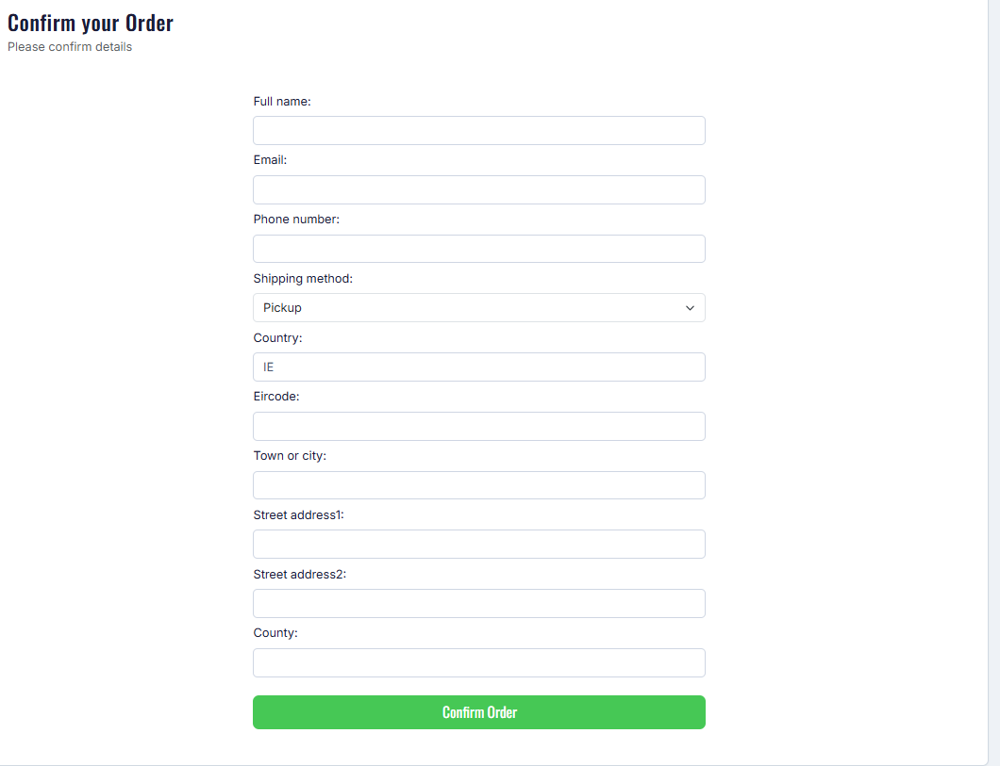

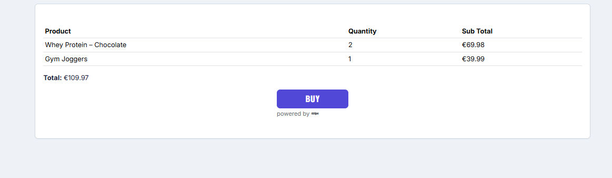

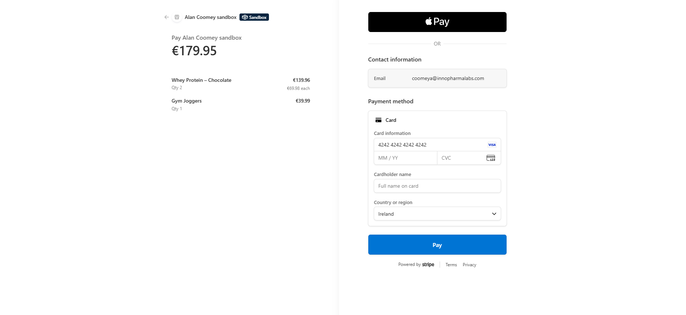
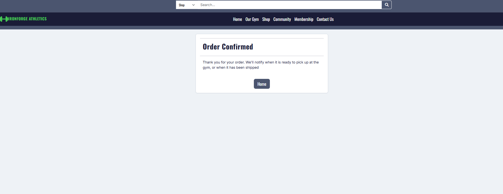

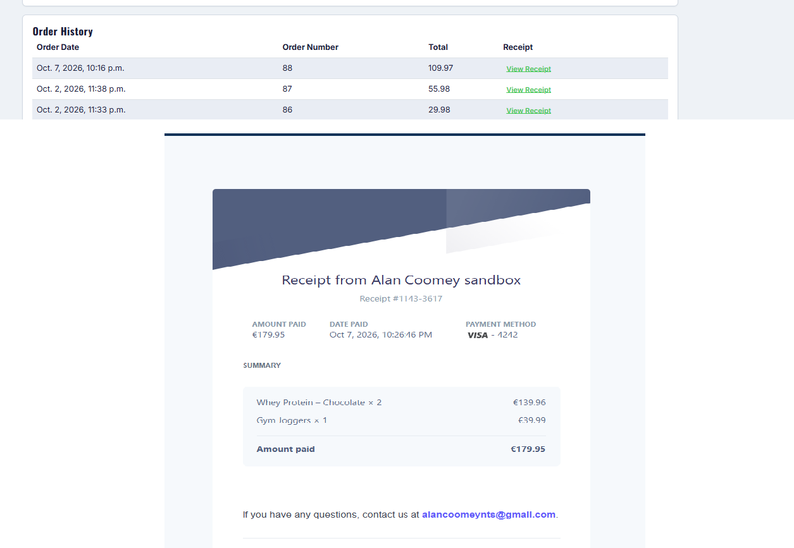

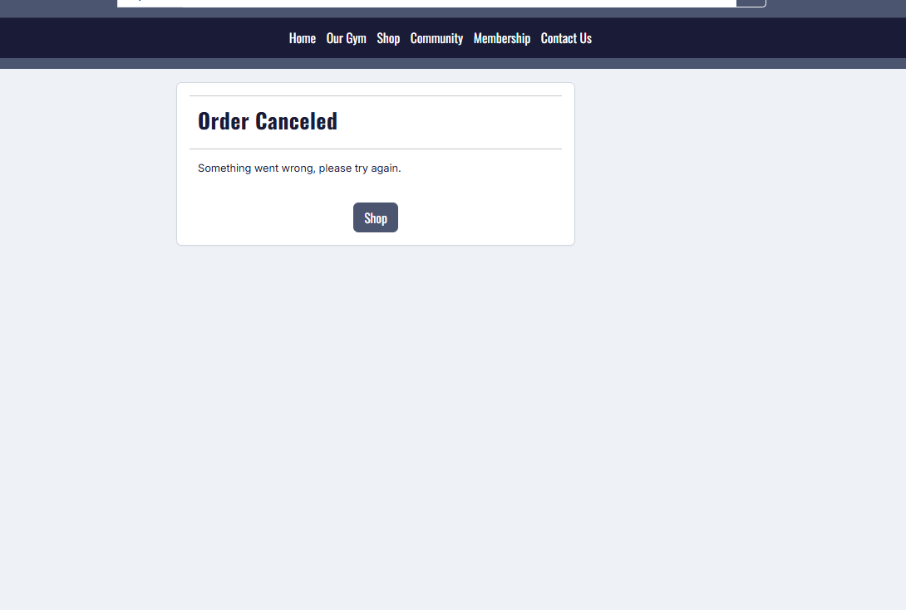


### 13. Community Board
**Description:**
Member-only community area where active members and staff can share updates, achievements, and comments.
**Details:**
- Active members can access the community board.
- Staff users can also access the community area.
- Members can create posts.
- Posts can be saved as drafts or published.
- Published posts appear on the community board.
- Users can view individual post detail pages.
- Users can comment on posts.
- Post authors and staff can edit or delete posts where permitted.
- Comment authors and staff can edit or delete comments where permitted.
- Community content supports the project goal of building an engaged gym community.
**Technical Details:**
- Community access is protected by membership or staff checks.
- Posts, post images, and comments are stored in the database.
- Uses Django forms for post and comment submission.
- Uses slug-based post URLs.
- Pagination is used on the community board.
- Django messages provide feedback for create, edit, delete, and comment actions.

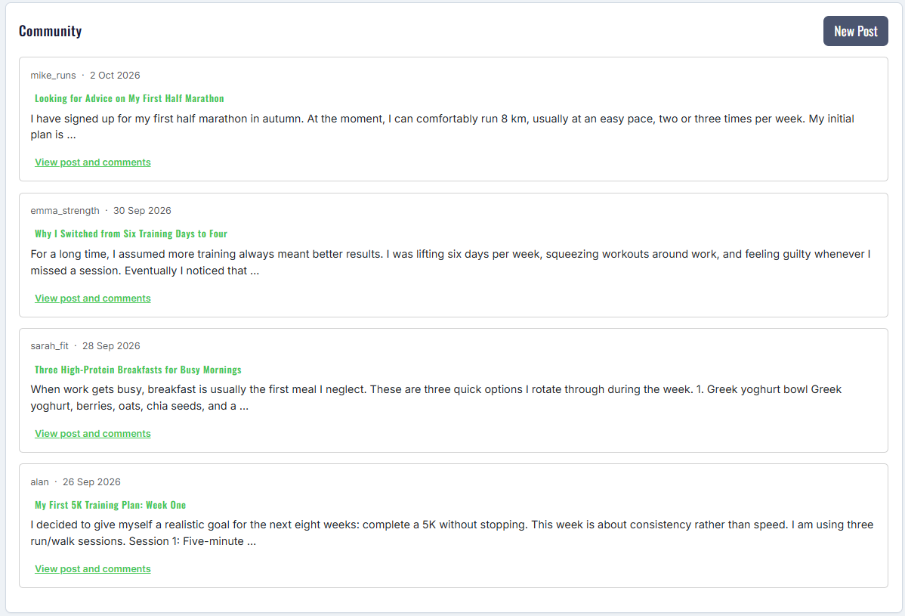
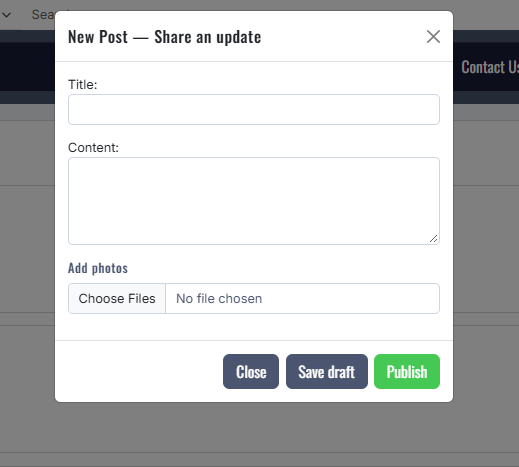
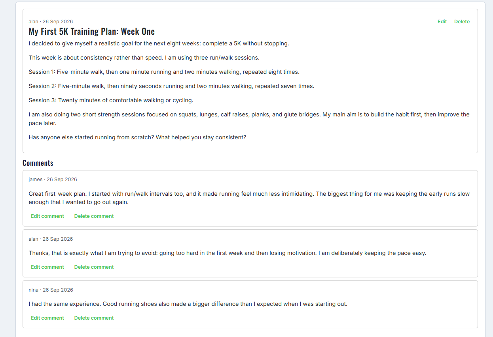
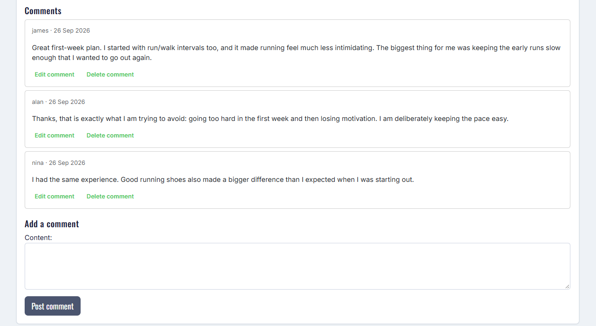


### 14. Admin Management

**Description:**  
Django admin interface allows staff and superusers to manage key site data and moderate platform content.

**Details:**

Administrators can manage:

- Gym information.
- Contact submissions.
- User profiles.
- Membership types.
- Membership records.
- Product categories.
- Products.
- Product reviews.
- Orders and order items.
- Community posts.
- Community comments.
- Post images.
- Stripe event logs.


**Technical Details:**

- Uses Django admin model registration.
- Selected admin views include list displays, filters, search fields, and inline relationships.
- Summernote supports rich text editing for selected content areas.
- Admin tools support shop management, membership management, and community moderation.
- Stripe event logs support tracking processed webhook events.

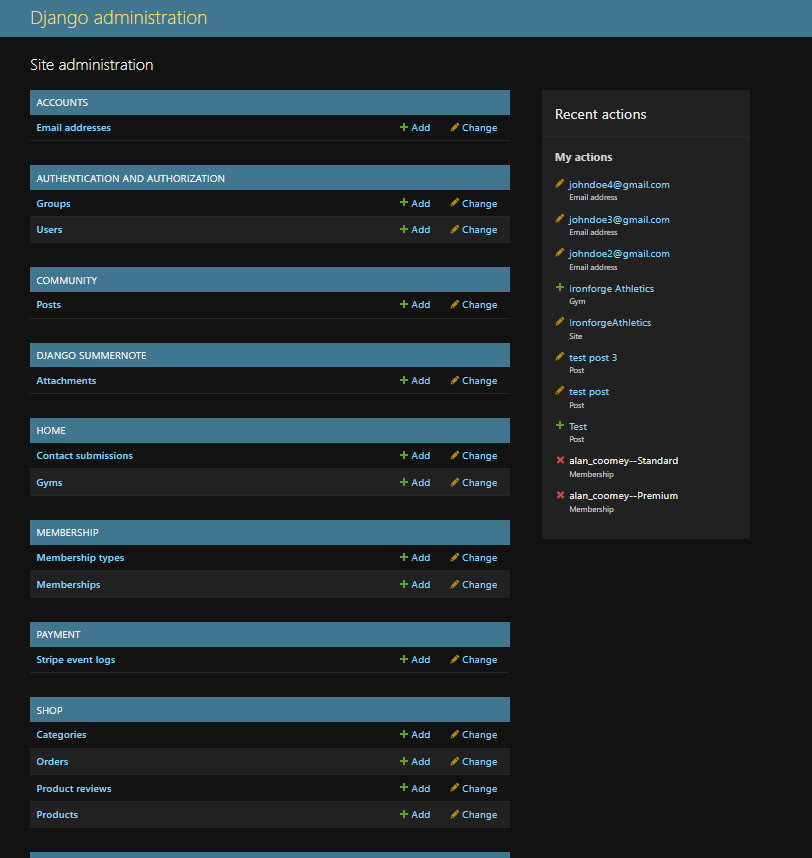

### 15. Feedback Messages and Toast Notifications
**Description:**
User feedback system that confirms actions and communicates errors throughout the site.
**Details:**
- Success messages are shown after completed actions.
- Error messages are shown when actions fail or are not permitted.
- Cart actions provide feedback when items are added, removed, or updated.
- Community actions provide feedback when posts or comments are created, edited, or deleted.
- Contact form submissions display confirmation messages.
- Membership and payment-related actions can display relevant feedback.
**Technical Details:**
- Uses Django messages framework.
- Toast notifications are styled with custom CSS.
- JavaScript initialises and displays Bootstrap toast components.
- Feedback messages improve usability by confirming the result of user actions.

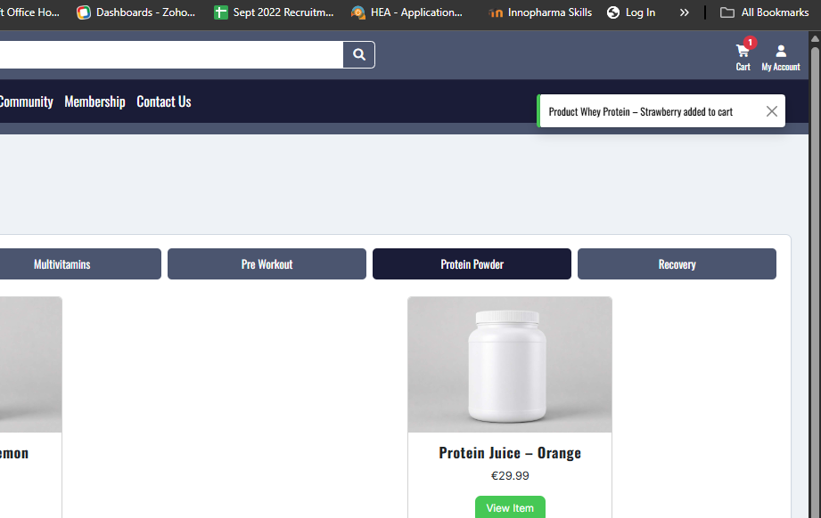

### 16. Miscellaneous Features

**Description:**  
Supporting interface features provide a more complete and consistent user experience across the site. This section covers smaller UI elements that support navigation, usability, error handling, and visual consistency.

**Details:**

- A consistent footer is displayed across the main site pages.
- Footer content remains accessible on smaller screens without overwhelming the layout.
- A branded custom 404 page is shown when users visit an invalid route.
- Icons are used to support visual clarity for actions such as cart access, account navigation, and item removal.
- Tooltips provide extra guidance for selected interactive elements.
- Shared layout styling keeps pages visually consistent across the public site, shop, membership area, dashboard, and community board.
- Responsive Bootstrap utilities are used throughout the project to keep content readable on mobile, tablet, and desktop screens.
- Basic search allows users to search relevant site areas such as shop products, members, or community posts.
**Technical Details:**

- Built with reusable Django template includes for shared layout sections such as the header, navigation, messages, and footer.
- Uses Bootstrap 5.3 components and responsive utility classes.
- Uses project-specific CSS variables for consistent colours, spacing, and branding.
- Font Awesome icons are used for visual support.
- The custom 404 template provides a branded fallback for invalid routes.
- Search uses query parameters and Django ORM filtering to return matching records for the selected search area.

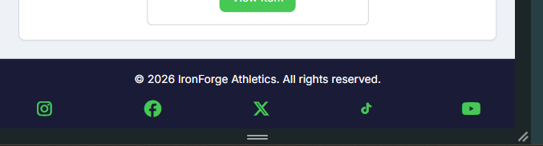
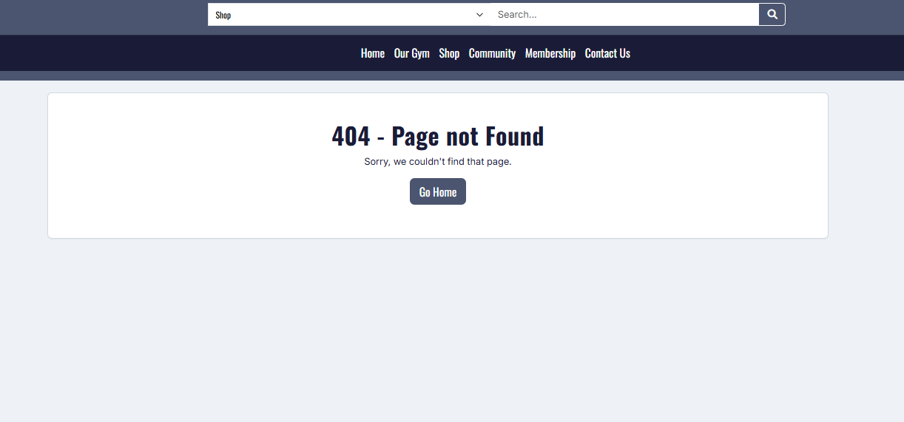
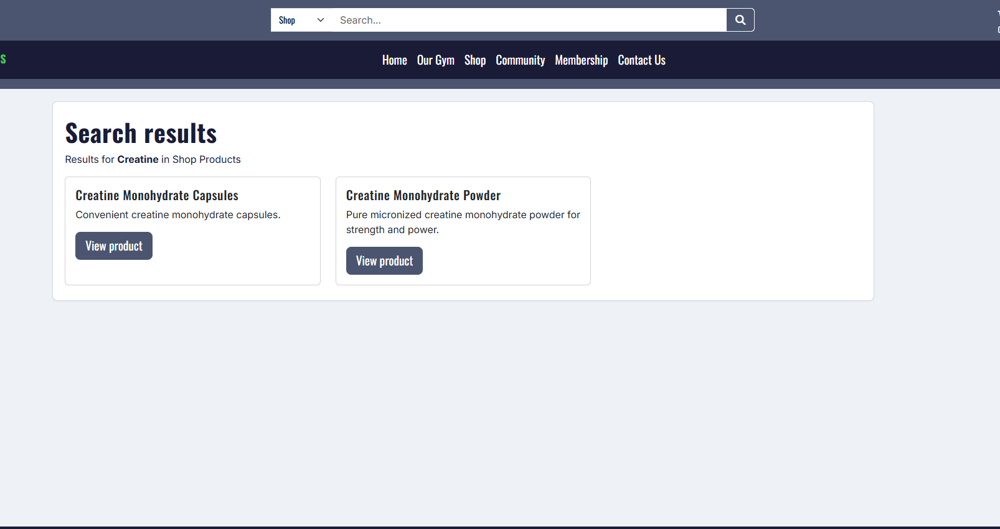

## Future Features
Future improvements planned for IronForge Athletics.

Planned originally but dropped due to time constraints:
- **Email Functionality** for Shop order and joining members.
- **Social login:** Add optional login through third-party providers such as Google.
- **Comment Threads:** Add comment threads to posts and comments. (Comment model already set up to be self-referencing.)

Future Enhancements:
- **Improved search:** Upgrade search functionality to free text search.
- **Enhanced community permissions:** Add more detailed moderation and reporting tools. Announcements and AMA with Coaches.
- **Admin Dashboard:** Create a dedicated admin dashboard for managing site content and Gym Member Analytics.
- **Video Content:** Add video content such as free classes and motivational videos.
- **Additional review controls:** Improve review moderation and allow administrators to manage inappropriate reviews more easily.
- **CRM**: Further develop Contact Us form into full sales CRM.

---

## Testing

Website was thoroughly tested using user personas and stories as a guide.

**User Story 1 – Gym facilities and services:** As a potential gym member, I want to learn about the gym's facilities and services so I can decide whether IronForge Athletics is right for me.

**Pathways Tested (all passed):**
- Homepage is available through the main navigation.
- About page is available through the main navigation.
- Contact page is available through the main navigation.
- Facilities, services, gym environment, and training information are clearly presented to visitors.
- Homepage hero section loads with strong gym branding and clear introductory content.
- Clear calls to action guide users toward registration and membership options.
- Location, opening hours, and contact information are easy to find.
- Marketing pages render consistently with the IronForge Athletics brand styling.
- Public pages are accessible to logged-out visitors.
- Marketing content remains readable and usable on desktop, tablet, and mobile screen sizes.

**User Story 2 – User registration:** As a potential gym member, I want to register for an account.

**Pathways Tested (all passed):**
- Registration page is accessible from the website navigation.
- Registration form collects the required account details.
- Form validation is handled correctly before account creation.
- Invalid registration data re-renders the form with clear validation errors.
- Valid registration creates a new user account.
- A user profile is automatically created for the new account.
- Email verification flow is available after registration.
- Navigation updates correctly after the user registers or logs in.

**User Story 3 – Membership plans and comparison:** As a potential gym member, I want to view my membership details so I can compare membership options and decide whether IronForge Athletics is right for me.

**Pathways Tested (all passed):**
- Membership plans page is accessible from the main navigation.
- Active membership plans are displayed on a dedicated public page.
- Each membership card displays the plan name, price, description, and benefits.
- Billing or pricing information is clearly visible.
- Membership options are presented in a clear card-based layout for easy comparison.
- Logged-out users can view all available membership plans.
- Logged-out users are prompted to register or log in before subscribing.
- Authenticated users can proceed toward subscription checkout from the selected plan.
- Existing members are guided toward membership management rather than duplicate subscription signup.
- Membership plan cards remain readable and well aligned across responsive breakpoints.

**User Story 4 – Membership subscription:** As a potential gym member, I want to subscribe to a membership so I can access fitness and nutrition resources.

**Pathways Tested (all passed):**
- Logged-in users can select a membership plan.
- Subscription action redirects users to Stripe-hosted checkout.
- Stripe Checkout displays the selected membership subscription details.
- Successful subscription redirects the user to a confirmation or success page.
- Successful subscription creates or updates the user’s membership record.
- Active membership status grants access to member-only areas where appropriate.
- Failed or cancelled subscription payments do not create an active membership.
- Users receive clear feedback when subscription payment is cancelled or unsuccessful.
- Users attempting to subscribe while already holding a membership are handled appropriately.
- Stripe webhook handling updates local membership information correctly.
- Resubscribing doesn't create new Stripe customer - view retrieves and reuses existing customer id.

**User Story 5 – View and manage subscription:** As a gym member, I want to view my subscription details so I can edit or cancel my subscription.

**Pathways Tested (all passed):**
- Logged-in members can access membership management from their account area.
- Membership status is displayed to the user.
- Current membership information is visible in the user dashboard or membership management area.
- Members can access the Stripe Customer Portal to manage their subscription.
- Stripe Customer Portal allows subscription updates or cancellation where configured.
- Non-members are redirected away from membership management and guided toward membership options.
- Subscription cancellation or updates are reflected locally through webhook updates.
- Interface clearly communicates membership status and subscription management options.
- Member-only access responds correctly when membership status changes.

**User Story 6 – Profile and account dashboard:** As a gym member, I want to view and edit my profile so I can share my fitness progress and review past shop orders.

**Pathways Tested (all passed):**
- Logged-in users can access their dashboard or profile area.
- Dashboard displays account and profile information.
- Profile page displays relevant details such as username, bio, goals, and fitness information where provided.
- Profile edit page is accessible to authenticated users.
- Profile edit form allows users to update editable profile fields.
- Valid profile updates are saved successfully.
- Updated profile information is reflected immediately after saving.
- Invalid profile form submissions are re-rendered with validation feedback.
- Dashboard displays membership information where applicable.
- Dashboard provides access to shop order history.
- Dashboard displays or links to the user’s community activity where applicable.

**User Story 7 – Community message board:** As a gym member, I want to view a gym message board so I can stay informed about the gym's activities and community, and share my fitness achievements with other members.

**Pathways Tested (all passed):**
- Community board is accessible to active members and staff users.
- Non-members are restricted from accessing the member-only community area.
- Published community posts display correctly on the community board.
- Users can open individual post detail pages.
- Active members can create community posts.
- Posts can be saved with the correct published or draft state where available.
- Members can share fitness achievements and progress updates through community posts.
- Users can comment on posts.
- Post authors and staff can edit or delete posts where permitted.
- Comment authors and staff can edit or delete comments where permitted.
- Feedback messages are displayed after creating, editing, or deleting posts and comments.
- Pagination works correctly where multiple posts are available.

**User Story 8 – Browse products:** As a shop customer, I want to browse products so I can find the products that interest me.

**Pathways Tested (all passed):**
- Shop or product catalogue page is accessible from the main navigation.
- Product catalogue is publicly accessible without requiring login.
- Active products are displayed in the catalogue.
- Product cards display the product name, price, and image where available.
- Product categories or filters allow users to browse by product type.
- Each product card links to its product detail page.
- Product catalogue remains readable and navigable on mobile, tablet, and desktop devices.

**User Story 9 – Product detail page:** As a shop customer, I want to view product details so I can decide whether to purchase the product.

**Pathways Tested (all passed):**
- Product detail pages open correctly from the product catalogue.
- Product name is clearly displayed.
- Product price is clearly displayed.
- Full product description is visible.
- Product image or fallback image displays correctly.
- Quantity selection is available before adding to cart.
- Add to Cart button is present and functional.
- Product reviews are displayed where reviews exist.
- Logged-in users can submit product reviews.
- Review rating validation works correctly.
- Duplicate review restrictions are enforced where applicable.
- Product detail layout remains readable across responsive screen sizes.

**User Story 10 – Add products to cart:** As a shop customer, I want to add the product to my cart so I can purchase multiple products at once.

**Pathways Tested (all passed):**
- Users can add products to the cart from product detail pages.
- Quantity selected by the user is reflected in the cart.
- Adding an existing product updates the quantity instead of creating an incorrect duplicate line.
- Cart contents are retained in the session while browsing.
- Anonymous users can add products to the cart.
- Logged-in users can add products to the cart.
- Cart icon or cart navigation updates appropriately after products are added.
- Toast or feedback message confirms when a product is added to the cart.
- Invalid quantities are rejected or handled safely.

**User Story 11 – View and manage cart:** As a shop customer, I want to view my cart so I can review my order before checkout.

**Pathways Tested (all passed):**
- Cart page is accessible from the cart link.
- Cart page displays all selected products.
- Each cart item displays product name, quantity, item price, and line total.
- Cart subtotal and total are displayed clearly.
- Users can update item quantities.
- Cart totals update correctly when quantities change.
- Users can remove items from the cart.
- Empty cart state is shown clearly when no products are present.
- Checkout call to action is clearly visible when the cart contains items.
- Cart layout remains usable on mobile and desktop devices.

**User Story 12 – Secure checkout:** As a shop customer, I want to complete checkout securely so I can purchase the products in my cart.

**Pathways Tested (all passed):**
- Users must be logged in before completing checkout.
- Logged-out users attempting checkout are redirected or prompted to log in.
- Checkout page collects required order and delivery or pickup information.
- Checkout calculates product totals correctly.
- Shipping or delivery costs are applied where relevant.
- Member discounts are applied where applicable.
- Confirming an order creates a pending order record.
- Order items are created from the cart contents.
- User is redirected to Stripe Checkout for secure payment.
- Successful payment redirects to the payment success page.
- Successful payment updates the order status to paid.
- Stripe receipt URL is stored or made available where applicable.
- Cart is cleared after successful checkout confirmation.
- Cancelled payment redirects to the payment cancelled page.
- Failed payments display or trigger clear feedback and do not incorrectly mark the order as paid.

**User Story 13 – Admin management:** As site administrator, I want to be able to manage users, memberships, products, shop orders, and the message board.

**Pathways Tested (all passed):**
- Staff and superusers can access the Django admin panel.
- Non-staff users cannot access admin management tools.
- Admin users can manage user accounts and user profiles.
- Admin users can create, view, update, and delete membership plans.
- Admin users can view and update membership records.
- Admin users can manage product categories and products.
- Admin users can view and edit product reviews.
- Admin users can view and manage shop orders and order items.
- Admin users can review contact form submissions.
- Admin users can manage community posts, comments, and post images.
- Admin users can moderate community content by editing or deleting inappropriate posts or comments.
- Admin list views provide useful search, filtering, or display fields where configured.
- Stripe event logs can be viewed.
- Changes made in the admin panel are reflected correctly on the public website.

**User Story 14 – Homepage, navigation, feedback, and responsive design:** As a visitor, member, shop customer, or administrator, I want the website interface to be clear, responsive, and easy to use so that I can complete key tasks on any device.

**Pathways Tested (all passed):**

**Homepage and navigation:**
- Homepage loads with IronForge Athletics branding clearly visible.
- Main navigation includes links to key areas such as Home, About, Contact, Memberships, Shop, Community, Cart, and account actions where appropriate.
- Navigation updates based on whether the user is logged in, logged out, a member, or staff user.
- Calls to action for registration, memberships, and shopping are clearly identifiable.
- Active navigation styling helps users understand their current location.
- Footer appears consistently across main site pages.
- Footer contains useful supporting information and links.

**Feedback messages:**
- Success messages display after completed actions such as registration, profile updates, cart changes, contact form submission, and community actions.
- Error messages display when actions fail or are not permitted.
- Toast notifications display correctly.
- Feedback messages are visually consistent with the site design.
- Users receive clear confirmation after important actions.

**Mobile (< 576px):**
- Navigation collapses into a mobile-friendly layout.
- Homepage sections stack vertically without overlapping content.
- Membership cards stack into a single-column layout.
- Product catalogue cards display clearly in a single-column layout.
- Product detail content remains readable.
- Forms use full-width inputs and remain easy to complete.
- Cart and checkout content remain usable without layout breakage.
- Dashboard sections stack cleanly.
- Buttons remain large enough for touch interaction.
- Footer content remains accessible without cluttering the screen.

**Tablet (576px – 992px):**
- Navigation remains clear and usable.
- Marketing content remains readable and aligned.
- Membership cards and product grids expand cleanly where screen space allows.
- Forms, dashboard content, cart pages, and checkout pages remain readable.
- Buttons and calls to action remain accessible.
- Images scale proportionally without distortion.

**Desktop (992px and above):**
- Full navigation layout displays with expected links visible.
- Homepage sections use wider layouts where intended.
- Membership cards display in a clear multi-column layout.
- Product catalogue displays in a multi-column grid.
- Product detail pages make effective use of wider screen space.
- Dashboard, cart, and checkout pages display comfortably.
- Footer displays full desktop content.

**Responsive behavior across all screen sizes:**
- Images scale proportionally without visible distortion.
- Text remains readable and does not overflow containers.
- Buttons and links remain accessible and usable.
- Bootstrap breakpoint transitions occur without major layout issues.
- Site branding, colour scheme, and typography remain consistent across devices.


### JavaScript Manual Testing

#### Community.js

| Test Case                             | Input                                                                                                                    | Expected                                                                                                                                                                                 | Actual                                                                                                      | Status | Screenshot                                                                                       | Suggested Manual Testing (DevTools)                                                                                                                               |
|---------------------------------------|--------------------------------------------------------------------------------------------------------------------------|------------------------------------------------------------------------------------------------------------------------------------------------------------------------------------------|-------------------------------------------------------------------------------------------------------------|--------|--------------------------------------------------------------------------------------------------|-------------------------------------------------------------------------------------------------------------------------------------------------------------------|
| Listeners active on post detail pages | Open a post detail page and inspect the edit/delete modal elements in DevTools.                                          | show.bs.modal listeners are attached to the edit/delete modals targeted by the custom JavaScript.                                                                                        | show.bs.modal listeners were attached to the available edit/delete modal elements.                          | PASS   | 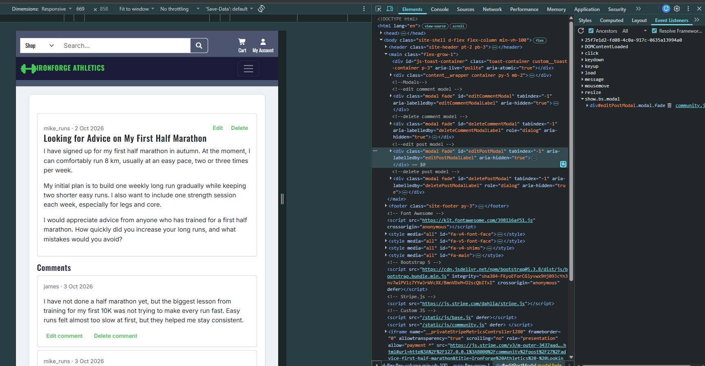 | In the Elements panel, select an edit/delete modal element, open Event Listeners, and check for show.bs.modal.                                                    |
| Edit comment modal populates          | Click an edit comment button with valid data attributes.                                                                 | The edit comment form action is set to the selected comment edit URL, and the comment field is populated with the selected comment content.                                              | The edit comment form action was set correctly, and the comment content field populated correctly.          | PASS   | 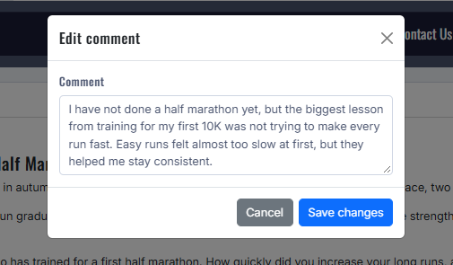               | **Elements panel** → inspect the edit comment form action and comment field value. Console panel → check the comment field value after opening the modal.         |
| Delete comment modal populates        | Click a delete comment button with a valid delete URL data attribute.                                                    | The delete comment confirmation form action is set to the selected comment delete URL.                                                                                                   | The delete comment confirmation form action was set correctly.                                              | PASS   | 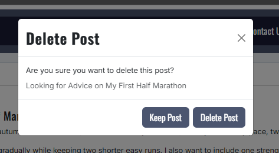           | **Elements panel** → inspect the delete comment confirmation form action. Console panel → check the form action after opening the modal.                          |
| Edit post modal populates             | Click an edit post button with valid post edit URL and post title data attributes while post content exists on the page. | The edit post form action is set to the selected post edit URL. The title field is populated with the selected post title. The content field is populated with the current post content. | The edit post form action, title field, and content field populated correctly.                              | PASS   | 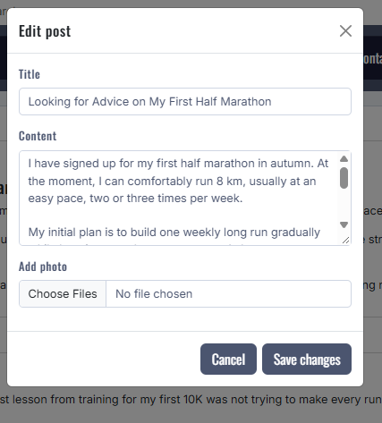                     | **Elements panel** → inspect the edit post form, title field, and content field. Console panel → check the form action and field values after opening the modal.  |
| Delete post modal populates           | Click a delete post button with valid post delete URL and post title data attributes.                                    | The delete post confirmation form action is set to the selected post delete URL, and the modal confirmation text displays the selected post title.                                       | The delete post confirmation form action was set correctly, and the modal displayed the correct post title. | PASS   | 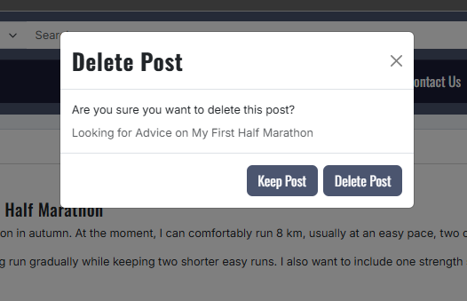                 | **Elements panel** → inspect the delete post confirmation form action and confirmation text. Console panel → check the confirmation text after opening the modal. |
#### Cart.js

| Test Case                  | Input                                                                                                                                           | Expected                                                                                                                                                              | Actual                                                                                                                                                                | Status | Screenshot                                                           | Suggested Manual Testing (DevTools)                                                                                            |
|----------------------------|-------------------------------------------------------------------------------------------------------------------------------------------------|-----------------------------------------------------------------------------------------------------------------------------------------------------------------------|-----------------------------------------------------------------------------------------------------------------------------------------------------------------------|--------|----------------------------------------------------------------------|--------------------------------------------------------------------------------------------------------------------------------|
| Successful quantity update | Open the cart page, open DevTools, change a product quantity to a valid value, then submit its `.shop__update-form`.                            | Page does not reload. `#line-total-{productId}`, `#cart-total`, and `#cart-count` update from the JSON response. A toast appears with `data.message` and `data.type`. | Page does not reload. `#line-total-{productId}`, `#cart-total`, and `#cart-count` update from the JSON response. A toast appears with `data.message` and `data.type`. | PASS   | 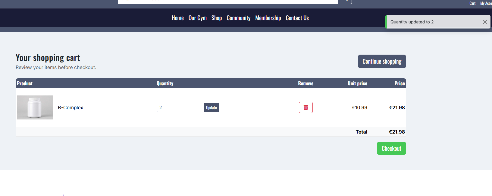 | **Elements panel:** Inspect `data-product-id` on each form and the matching `id="line-total-{productId}"`.                     |
| Invalid quantity           | Open the cart page, change a product quantity to an invalid value such as `0`, `-1`, or non-numeric text, then submit its `.shop__update-form`. | Page does not reload. Existing line total, cart total, and cart count remain unchanged. An error displays.                                                            | Page does not reload. Existing line total, cart total, and cart count remain unchanged. An error displays.                                                            | PASS   | 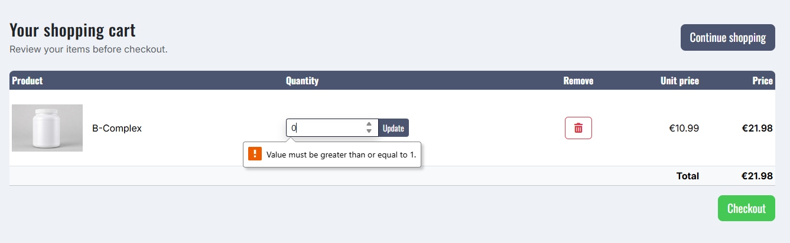 | **Elements panel:** Confirm that the existing line total, cart total, and cart count values remain unchanged after submission. |
#### Base.js

| Test Case                                                            | Input                                                                                                                                         | Expected                                                                                                                                                                       | Actual                                            | Status | Screenshot                                                                                                                                                  | Suggested Manual Testing (DevTools)                                                                         |
|----------------------------------------------------------------------|-----------------------------------------------------------------------------------------------------------------------------------------------|--------------------------------------------------------------------------------------------------------------------------------------------------------------------------------|---------------------------------------------------|--------|-------------------------------------------------------------------------------------------------------------------------------------------------------------|-------------------------------------------------------------------------------------------------------------|
| `showToast()` displays a success toast                               | Open a page containing `<div id="js-toast-container"></div>`, open DevTools, and run `showToast("Review submitted successfully", "success")`. | A new `.toast` element is appended to `#js-toast-container`. It has class `custom__toast--success`, contains the message “Review submitted successfully”, and becomes visible. | Toast created with correct styling.               | PASS   |                                                                                                                         | **Elements:** Inspect `#js-toast-container` before and after running the function.                          |
| `showToast()` defaults to success when type is omitted               | In DevTools, run `showToast("Default toast type test")`.                                                                                      | A toast is displayed with the `custom__toast--success` class, because `type` defaults to `"success"` when `null` is passed.                                                    | Toast defaults to `success`.                      | PASS   | 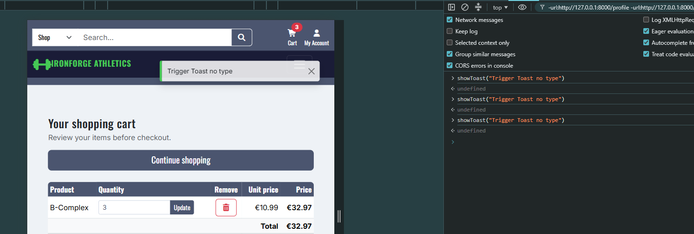                                                                                 | **Elements:** Inspect the newly created toast and confirm its class list includes `custom__toast--success`. |
| `initialiseRatingRadio()` updates stars on product review submission | Open a product-detail page, select a rating, and submit the review form.                                                                      | The first four `<i>` elements receive `class="fa-solid fa-star review__star"`, while the fifth receives `class="fa-regular fa-star"`.                                          | Review is added with the correct number of stars. | PASS   | 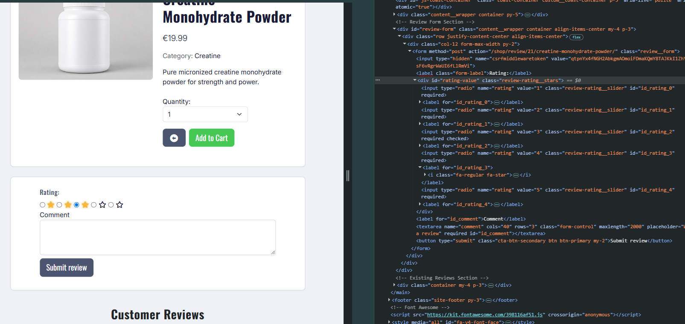 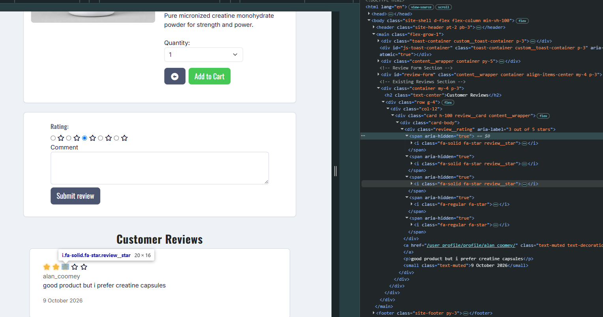 | **Elements:** Inspect `#rating-value` before and after selecting the rating.                                |
---

### Automated Python Testing
Automated tests were created using Django’s built-in testing framework to verify core backend functionality, including views, authentication, Stripe SDK, database operations, and business logic.
#### Running tests
```bash
python manage.py test
```
All automated Django tests passed successfully.
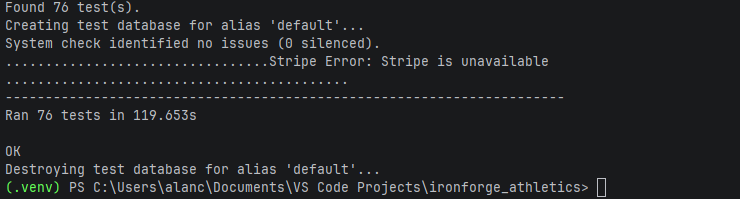


### Stripe Integration Testing 
Stripe’s CLI lets you forward test webhook events to your local Django server, so you can verify payment handling without deploying the app.
1. Run Django locally: python manage.py runserver.
2. In another terminal, start the listener:
3. stripe listen --forward-to localhost:8000/checkout/webhook/
4. Copy the printed whsec_... signing secret into your local environment/settings.
5. Trigger an event: stripe trigger checkout.session.completed.
6. Check the Django logs and database to confirm the order status, and other post-payment logic updates.
7. Failure cases were tested too,  and used to confirm invalid signatures are rejected.
8. The Stripe developer dashboard was used to test the Stripe integration with the Django backend and the Stripe test clock was to test subscription workflows.


### Validation and Accessibility Testing

#### HTML Validation
Rendered HTML files were validated using the W3C Markup Validation Service and djlint. Any issues identified were corrected during development.
#### CSS Validation
The custom CSS file was tested using the W3C CSS Validation Service.
#### JavaScript Validation
JavaScript was tested using JSHint. All scripts passed without major errors, utilizing the following configuration:
```
/* jshint esversion: 8 */
/* bootstrap: true*/
```
#### Python Validation
Python files were tested using Ruff. All files passed without major errors.
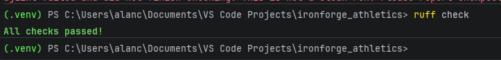

#### Lighthouse Testing

Lighthouse was used to test performance, accessibility, best practices, and SEO across key pages. Most pages scored 70+ points on each category except for product list and Contact Us.

---

## Code
### Code Sources and Credits
The following resources were used for guidance, implementation support, and debugging during development. Implementation
was guided by course material, official documentation, and selected tutorials, with additional adaptation and
problem-solving carried out during development.
#### Django 5 by Example by Antonio Melé:
Reference textbook to support course material. Used for Django ORM, templates, models, permissions, view patterns. Also
as insight into profile blog, shop, and message board app design. Of particular use were chapters 1,2,7,8 and 9.
#### BEM Methodology for CSS  -
sources: https://getbem.com/ and https://bem.info/en/methodology/naming-convention/
#### Django Introduction to Class Based Views -
sources: Learn Django - Class Based Views Course by Very Academy: https://www.youtube.com/watch?v=GxA2I-n8NR8&list=PLOLrQ9Pn6caxNb9eFZJ6LfY29nZkKmmXT
#### Django AllAuth Customization -
Tutorials Series by BugBytes: https://www.youtube.com/playlist?list=PL-2EBeDYMIbQqZZoo5Dj8YAkPnZeJfcZS
#### AJAX methods:
sources -Course material (Boutique-Ado), Django 5 by example chapter 6, online tutorial:
#### Custom Django Signals: https://stackandstories.vercel.app/blog/django-signals-beginner-to-advanced
#### Retrieve Stripe Receipt from Checkout Session Completed: https://stackoverflow.com/questions/28814791/stripe-receipt-url
#### Bootstrap 5: 
- https://getbootstrap.com/docs/5.3/getting-started/introduction/
#### Change bootstrap table styles: https://getbootstrap.com/docs/5.3/content/tables/
#### Permission Decorators: https://www.geeksforgeeks.org/python/creating-custom-decorator-in-django-for-different-permissions/
#### Django transactions:
- https://docs.djangoproject.com/en/5.0/topics/db/transactions/
- https://medium.com/@sunilnepali844/djangos-database-transaction-api-allows-developers-to-manage-database-operations-atomically-a56dabe13dd6
#### Stripe Python SDK:
-  https://stripe.com/docs/api/python
##### Stripe Subscriptions:
- https://tomdekan.com/articles/stripe-subs?ref=yt
- https://testdriven.io/blog/django-stripe-subscriptions/
#### Stripe Checkout and webhooks:
- Code Institute Boutique-Ado Walkthrough project.
- Django 5 by Example chapter 9.
#### Cart helper class:
- Django 5 by Example chapter 8
#### Model properties:
- https://docs.djangoproject.com/en/5.0/ref/models/fields/#django.db.models.Field.property
#### Test Suite references:
- https://docs.djangoproject.com/en/5.2/topics/testing/tools/
- unittest.mock: https://docs.python.org/3/library/unittest.mock.html
- Stripe Automated Testing: https://docs.stripe.com/automated-testing
#### Gmail SMTP: used setting from the following tutorial: https://www.codingforentrepreneurs.com/blog/sending-email-in-django-from-gmail


### Bugs and Fixes
#### AllAuth
- I encountered several deprecation errors using settings from the 0.50 version of allauth. I resolved by replacing deprecated settings with the new ones.
#### Amazon S3
- I encountered an error when trying to deploy the application to Heroku with s3 bucket for static and media files.
Solved by switching to a WhiteNoise and Cloudinary solution.
#### Automated Testing
- With Whitenoise, tests were failing because the static files were not being served. Solved with collectstatic command.
#### Unresolved bugs
- Integrity error when double clicking publish new post button. Tried to fix using JS to disable the button but couldn't implement before deadline.
Another solution considered is idempotent key and log to handle multiple identical submissions to a view.

---

## Tools and Resources
**Development Environment:**
- PyCharm for code editing and debugging
- GitHub for version control
- Heroku for deployment
**Languages & Frameworks:**
- HTML5, CSS, JavaScript ES8 for frontend development
- Bootstrap 5.3 for responsive design and components
- Python 3.12 for backend development
- Django 5.2 framework for web application architecture
**Libraries & UI Components:**
- Font Awesome for icons
**Validation & Testing Tools:**
- W3C Markup Validation Service and djlint Python package for HTML validation
- W3C CSS Validation Service for CSS validation
- JSHint for JavaScript linting and error checking
- Lighthouse for performance and accessibility testing
**Content & Design Tools:**
- Perplexity for discovery, text content generation, suggest Python tests and generating test data, and drafting documentation.
- Artlist.io for generative image creation
- Draw.io for entity relationship model

---

## Deployment

### Heroku Deployment

This project was deployed to Heroku.

### Deployment Steps

1. Create a new Heroku app.
2. Connect the Heroku app to the GitHub repository.
3. Add the required config vars in Heroku Settings.
4. Add a PostgreSQL database using the Heroku database add-on or external database provider.
5. Push the project to GitHub.
6. Deploy the selected branch from Heroku.
7. Run migrations.
8. Create a superuser.
9. Load fixture data if required.

### Required Config Variables

| Key                 | Purpose                                |
|---------------------|----------------------------------------|
| `DATABASE_URL`      | PostgreSQL database connection string  |
| `SECRET_KEY`        | Django secret key                      |
| `CLOUDINARY_URL`    | Cloudinary media storage configuration |
| `STRIPE_SECRET_KEY` | Stripe API secret key                  |
| `STRIPE_WH_SECRET`  | Stripe webhook secret key              |
| `DEVELOPMENT`       | Set to '1' for development environment |


### Local Deployment

To run this project locally:

1. Clone the repository.
2. Create and activate a virtual environment.
3. Install dependencies.
4. Create an `env.py` file with required environment variables.
5. Run migrations.
6. Start the development server.

```bash
python -m venv .venv
source .venv/bin/activate
pip install -r requirements.txt
python manage.py migrate
python manage.py runserver
```
### Stripe Configuration
Portal settings: Stripe portal settings are configured in the Stripe dashboard.
  - Next generation portal was enabled.
  - Settings allow customers to view history, update their information, update and cancel their subscriptions.
- Webhooks: directed at the Django server. URL: https://ironforge-athletics-11c14a1e531e.herokuapp.com/payment/webhook/ using webhook signing secret found in the Stripe developer console.
- Payment methods: Set to allow Card and Wallet payments only.
